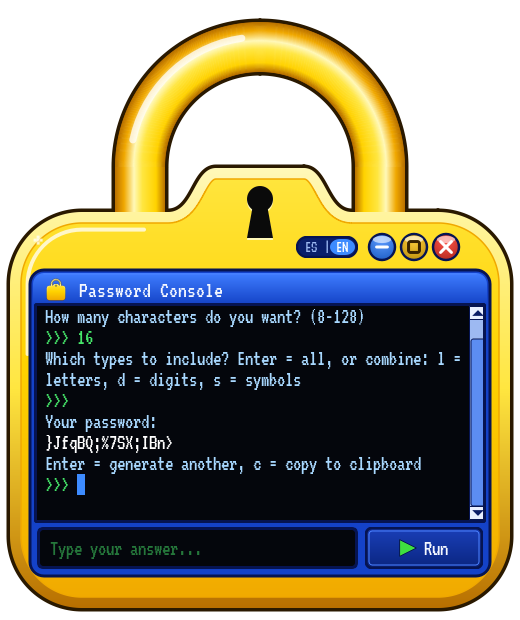
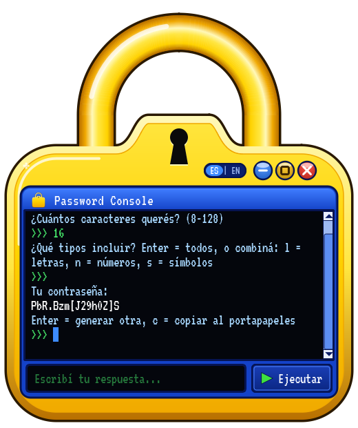

# Secure Password Generator

[](https://github.com/AlvaroAramayoChain/SecurePasswordGenerator/actions/workflows/ci.yml)


<p align="center">
  
  &nbsp;&nbsp;
  
</p>

A cryptographically secure random password generator with a retro, padlock-shaped
desktop app (Spanish and English), a command-line interface and a small,
reusable Python API.

## Features

- **Cryptographically secure**: built on Python's `secrets` module, never `random`.
- **Y2K desktop app**: a glossy, padlock-shaped window with a guided "Password
  Console". It asks for the length, then the character types, and shows the
  password. Press Enter for another password or `c` to copy it.
- **Bilingual**: Spanish and English, picked automatically from your system
  language, with an **ES | EN** toggle on the padlock.
- **Configurable**: 8 to 128 characters; letters (upper and lower case), digits
  and symbols (`!@#$%^&*()-_=+[]{};:,.<>?`) in any combination.
- **Guaranteed coverage**: every selected category appears at least once, at a
  random position.
- **Command line and library**: `python main.py --cli`, or
  `from passgen import generate_password`.
- **Native downloads** for Windows, macOS and Linux, plus Docker for development.

## Download

Ready-to-run builds are attached to every release on the
**[Releases page](https://github.com/AlvaroAramayoChain/SecurePasswordGenerator/releases)**:

| System  | File                                       | How to start                                             |
| ------- | ------------------------------------------ | -------------------------------------------------------- |
| Windows | `SecurePasswordGenerator-windows.zip`      | Unzip, then run `SecurePasswordGenerator.exe`            |
| macOS   | `SecurePasswordGenerator-macos.zip`        | Unzip, then open `SecurePasswordGenerator.app`           |
| Linux   | `SecurePasswordGenerator-linux.tar.gz`     | `tar xzf …`, then run `SecurePasswordGenerator/SecurePasswordGenerator` |

The apps are **not code-signed**, so your system will warn you the first time:

- **Windows SmartScreen** shows "Windows protected your PC". Click
  **More info**, then **Run anyway**.
- **macOS Gatekeeper** says the app "cannot be opened" or "is not from an
  identified developer". Open it once, then go to **System Settings → Privacy
  & Security**, scroll down and click **Open Anyway**. Alternatively, from
  Terminal: `xattr -dr com.apple.quarantine SecurePasswordGenerator.app`.
  The macOS build targets **Apple Silicon (arm64) only**. On Intel Macs,
  [run from source](#run-from-source) for now.
- **Linux**: the transparent padlock shape needs a **compositing** window
  manager. Every modern desktop has one: GNOME, KDE Plasma, Xfce with
  compositing enabled, and any Wayland session. Without one, the window still
  works but shows a thin dark rim around the padlock; set `PASSGEN_OPAQUE=1` to
  paint a solid background instead. The Linux build is made on Ubuntu 22.04
  and needs glibc 2.35 or newer (Ubuntu 22.04+, Debian 12+, Fedora 36+ and
  other distributions from 2022 on). On older systems, run from source.

## Language

The interface speaks **Spanish** and **English**:

- On first launch it follows your system language: any `es*` locale selects
  Spanish, everything else selects English.
- Click **ES** or **EN** on the pill next to the window buttons to switch. The
  console restarts in the new language.
- Your choice is remembered for next time. Only the language code is stored
  (via `QSettings`), never any password.

Each language has its own character-type keys:

| Language | Letters | Digits | Symbols | Copy |
| -------- | ------- | ------ | ------- | ---- |
| Español  | `l` (letras) | `n` (números) | `s` (símbolos) | `c` |
| English  | `l` (letters) | `d` (digits) | `s` (symbols) | `c` |

Press Enter at the types question to include all of them, or combine keys
(for example `ln` in Spanish or `ld` in English).

## Run from source

Requires Python 3.10 or newer.

```bash
git clone https://github.com/AlvaroAramayoChain/SecurePasswordGenerator.git
cd SecurePasswordGenerator
python -m venv .venv
source .venv/bin/activate          # Windows: .venv\Scripts\activate
pip install -e ".[gui]"

python main.py                     # desktop app
python main.py --cli               # command-line version
```

Installing the package also provides two commands: `passgen-gui` (desktop app)
and `passgen` (CLI). The core generator has no third-party dependencies; only
the GUI needs PySide6 (Qt), via the `gui` extra.

## CLI usage

```text
usage: passgen [-h] [-l LENGTH] [--no-letters] [--no-digits] [--no-symbols]

Generate a cryptographically secure random password.

options:
  -h, --help           show this help message and exit
  -l, --length LENGTH  password length (8-128); asked interactively if omitted
  --no-letters         exclude letters (A-Z, a-z)
  --no-digits          exclude digits (0-9)
  --no-symbols         exclude special characters

Example: passgen --length 20 --no-symbols
```

```console
$ python main.py --cli
Password length (8-128): 16
q7}V;Rm2!xLc@9Tz

$ python main.py --cli --length 24 --no-symbols
b8KxQ2mVt7RzL4hNwP9cYs3D

$ python main.py --cli -l 10 --no-letters --no-symbols
4817305926

$ python main.py --cli --length 4
Error: Password length must be between 8 and 128 characters, got 4.
```

The CLI is English only. It exits with code `0` on success, `2` on invalid
input and `130` when cancelled (Ctrl+C or end of input).

## Use as a library

```python
from passgen import InvalidLengthError, PasswordGeneratorError, generate_password

password = generate_password(16)                         # all character sets
pin_like = generate_password(12, use_letters=False, use_symbols=False)

try:
    generate_password(200)
except InvalidLengthError as error:
    print(error.min_length, error.max_length)            # 8 128
except PasswordGeneratorError as error:                  # base class for all errors
    print(error)
```

| Exception                     | Raised when                                   |
| ----------------------------- | --------------------------------------------- |
| `InvalidLengthError`          | The length is outside 8-128 (`ValueError`).   |
| `InvalidLengthTypeError`      | The length is not an `int` (`TypeError`).     |
| `NoCharacterSetSelectedError` | Letters, digits and symbols are all disabled. |

The guided dialog behind the desktop app lives in `passgen.session` (pure
Python, no Qt), and its texts live in `passgen.strings`, one dictionary per
language. Adding a language only takes one more dictionary.

## Docker

Docker provides an identical environment for development, tests and the CLI.
The desktop app is packaged natively instead, so PySide6 is not installed in
the image and the GUI tests skip themselves there.

```bash
docker compose run --rm test                           # run the test suite
docker compose run --rm cli                            # interactive CLI
docker compose run --rm cli --length 20 --no-symbols   # CLI with flags
```

The image is based on `python:3.12-slim`, runs as a non-root user and contains
no secrets.

## Running tests

```bash
pip install -r requirements-gui.txt    # pytest + PySide6
python -m pytest
```

The GUI smoke tests run offscreen (`QT_QPA_PLATFORM=offscreen` is set
automatically) and use a temporary settings file, so they never touch your real
settings. Without PySide6 they are skipped. CI runs the full suite on Linux,
Windows and macOS with Python 3.10 to 3.13, and again inside Docker.

## Building the desktop app

```bash
pip install -e ".[build]"              # PySide6, PyInstaller, Pillow
python build.py --verify --archive
```

This creates `dist/SecurePasswordGenerator/` (`.app` on macOS), runs the
packaged app's offscreen self-test, and writes
`dist/SecurePasswordGenerator-<os>.zip` (`.tar.gz` on Linux). PyInstaller cannot
cross-compile, so build on each operating system you want to ship.

The default is a **one-folder** build. `python build.py --onefile` produces a
single executable instead:

|                     | One folder (default)          | One file                                    |
| ------------------- | ----------------------------- | ------------------------------------------- |
| Startup             | Instant                       | 2-5 s: unpacks Qt to a temp folder each run |
| Antivirus           | Rarely flagged                | Self-extracting exes are flagged far more often |
| macOS               | Proper `.app` bundle          | Deprecated by PyInstaller with `--windowed` |
| Distribution        | A folder (shipped zipped)     | A single file                               |

To regenerate the icons and README screenshots from the drawing code, run
`python tools/make_assets.py`.

## Publishing a release

Push a version tag. The [release workflow](.github/workflows/release.yml)
builds, self-tests and archives the app on Windows, macOS and Linux, then
attaches the three archives to a new GitHub Release:

```bash
git tag v1.0.0
git push origin v1.0.0
```

## Security

- Every character is chosen with `secrets.choice`, and the final order is
  shuffled with `secrets.SystemRandom`. Both use the operating system's
  cryptographically secure random number generator.
- One character is drawn from each selected category, the rest come from the
  combined pool, and the result is securely shuffled, so required characters
  never sit at predictable positions.
- **Nothing is stored, logged or sent anywhere.** Passwords exist only in
  memory and on your screen, and the app makes no network connections. The
  only persisted setting is the interface language code.
- The `c` command puts the password on the system clipboard, where it stays
  until you copy something else. Clear it after pasting if others use your
  computer.

## Roadmap

- [x] Secure generation backend with a reusable API
- [x] Command-line interface
- [x] Docker image and cross-platform CI
- [x] Padlock-shaped desktop GUI, packaged natively for Windows, macOS and Linux
- [x] Spanish and English interface with automatic detection
- [ ] Code-signed and notarized builds
- [ ] Intel (x86_64) macOS build

## License

Released under the [MIT License](LICENSE). The bundled
[VT323](https://fonts.google.com/specimen/VT323) font is © The VT323 Project
Authors, licensed under the
[SIL Open Font License 1.1](src/passgen/gui/assets/OFL.txt).
