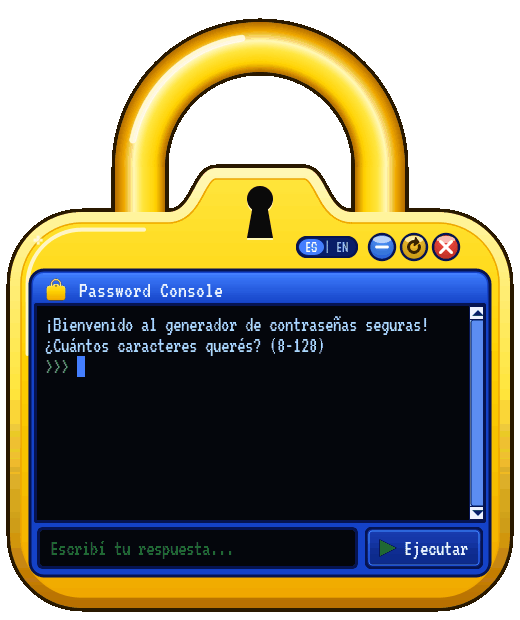
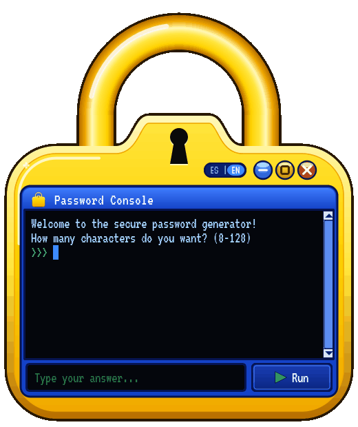

<p align="center">
  
</p>

<h1 align="center">Secure Password Generator</h1>

<p align="center">Strong random passwords from a retro padlock-shaped app, in Spanish or English.</p>

<p align="center">
  <a href="https://github.com/AlvaroAramayoChain/SecurePasswordGenerator/actions/workflows/ci.yml"></a>
  <a href="LICENSE"></a>
  <a href="https://github.com/AlvaroAramayoChain/SecurePasswordGenerator/releases/latest"></a>
</p>

<p align="center">
  
  &nbsp;
  
</p>

## Installation instructions

Every release on the **[Releases page](https://github.com/AlvaroAramayoChain/SecurePasswordGenerator/releases/latest)**
has one download per system. Each download is a **compressed archive (ZIP or
TAR) that contains the app**, not a single loose file, so extract it first.

### Windows

1. Download **`SecurePasswordGenerator-windows.zip`**.
2. Right-click it and choose **Extract All…**.
3. Open the extracted folder, then the **`SecurePasswordGenerator`** folder inside it.
4. Double-click **`SecurePasswordGenerator.exe`**.

Keep the `.exe` next to the `_internal` folder beside it, because the app needs
both. If Windows SmartScreen says "Windows protected your PC", click
**More info → Run anyway**. The warning appears because the app is not
code-signed.

### macOS (Apple Silicon only)

1. Download **`SecurePasswordGenerator-macos.zip`** and double-click it to extract.
2. Drag **`SecurePasswordGenerator.app`** into your **Applications** folder.
3. The first time, **right-click the app → Open**, then confirm. On macOS 15
   or newer, if there is no Open button, go to **System Settings → Privacy &
   Security** and click **Open Anyway**.

If macOS still refuses (the app is not notarized), run this once in Terminal:

```bash
xattr -dr com.apple.quarantine /Applications/SecurePasswordGenerator.app
```

The download is built for Apple Silicon (M1 and newer). On an **Intel Mac**,
use [Run from source](#run-from-source) instead.

### Linux

```bash
tar xzf SecurePasswordGenerator-linux.tar.gz
cd SecurePasswordGenerator
chmod +x SecurePasswordGenerator   # only if it is not already executable
./SecurePasswordGenerator
```

You need **glibc 2.35 or newer**, which means Ubuntu 22.04 or newer, or any
distribution from 2022 on. The transparent padlock shape needs a desktop with a
**compositor**, which GNOME, KDE Plasma and every Wayland session have. Without
one the app still works, with a thin dark rim around the padlock. Set
`PASSGEN_OPAQUE=1` to paint a solid background instead.

### Run from source

With Python 3.10 or newer:

```bash
git clone https://github.com/AlvaroAramayoChain/SecurePasswordGenerator.git
cd SecurePasswordGenerator
pip install -e ".[gui]"
python main.py
```

### Command-line mode

No window, just a password in your terminal:

```bash
python main.py --cli -l 20 --no-symbols
```

## How to use

1. **Length**: type how many characters you want (8 to 128) and press Enter.
2. **Character types**: press Enter for all of them, or combine the keys shown
   on screen. In English those are `l` letters, `d` digits, `s` symbols
   (`ld` = letters and digits); in Spanish `l` letras, `n` números, `s` símbolos.
3. **Your password** appears in the terminal.
4. Press **Enter** for another one, or type **`c`** to copy it to the clipboard.

To start over at any point, click the yellow **↻ restart** button next to the
minimize and close buttons, or press **Ctrl+R** (**Cmd+R** on macOS). It
clears the screen and forgets the last password, but leaves your clipboard
alone.

Click **ES | EN** on the padlock to switch language at any time. The app
starts in your system's language and remembers your choice.

## FAQ

### How it works

<details>
<summary><b>How does the program generate a password, step by step?</b></summary>

`generate_password()` in [`generator.py`](src/passgen/generator.py) does four things:

1. Checks the length is a whole number from 8 to 128.
2. Picks **one random character from each selected category** (uppercase,
   lowercase, digits, symbols), so every category is guaranteed to appear.
3. Fills the remaining positions with random characters from **all selected
   categories combined**.
4. **Shuffles** the result securely, so the guaranteed characters do not
   always sit at the start.

Every random choice uses Python's `secrets` module: `secrets.choice` for
characters and `secrets.SystemRandom().shuffle` for the order.

</details>

<details>
<summary><b>Why <code>secrets</code> and not <code>random</code>?</b></summary>

`random` is built for simulations and games. Its generator (Mersenne Twister)
is fast but predictable: after seeing enough outputs, its future values can be
calculated. `secrets` asks the operating system's cryptographically secure
random source instead, which is designed so that past outputs reveal nothing
about future ones. Python's own documentation recommends `secrets` for
passwords and tokens.

</details>

<details>
<summary><b>Does forcing at least one character per category weaken the password?</b></summary>

Barely: it costs about **0.32 bits** of entropy, measured exactly. For a
16-character password with all four sets enabled (a pool of 26 + 26 + 10 + 25 =
87 characters):

| Scenario | Entropy |
| --- | --- |
| Every character fully free: 16 × log₂(87) = 16 × 6.443 | **103.09 bits** |
| Uniform over passwords that contain every category | 102.85 bits |
| **This program** (one forced pick per category, then shuffle) | **102.76 bits** |

The rule excludes the 15% of 16-character strings that miss a category, and
the forced picks make some passwords slightly more likely than others.
Together that costs 103.09 − 102.76 = 0.32 bits, which means an attacker's
search space shrinks by a factor of 2^0.32 ≈ 1.25. That is negligible against
2^102.76 possibilities.

The program's figure is computed exactly, not estimated: a password with
category counts (a, b, c, d) is produced with probability
`a·b·c·d · 12! / (26·26·10·25 · 87^12 · 16!)`, and summing −p·log₂(p) over all
passwords gives 102.76 bits.

</details>

<details>
<summary><b>What characters are used, and why those symbols?</b></summary>

- Uppercase `A–Z` and lowercase `a–z` (26 each)
- Digits `0–9` (10)
- 25 symbols: `` !@#$%^&*()-_=+[]{};:,.<>? ``

The symbols are ASCII punctuation that password forms commonly accept. Spaces,
quotes (`'` `"` `` ` ``), backslash, slash, `|` and `~` are left out because
they often get rejected or cause escaping problems in terminals, config files
and URLs.

</details>

<details>
<summary><b>What are the length limits (8–128), and why?</b></summary>

They are the project's choices, stored as `MIN_LENGTH` and `MAX_LENGTH` in
[`generator.py`](src/passgen/generator.py). Eight is a widely used minimum and
leaves room for all four categories. For accounts protected only by a password,
longer is better: 16 is the default for the CLI and the library. 128 is far
beyond any practical need and keeps input reasonable. Anything outside the
range shows a friendly error and asks again.

</details>

<details>
<summary><b>Is my password stored, logged, or sent anywhere?</b></summary>

No. Passwords exist only in memory and on screen while the app is open. They
are never written to disk or logs, and the app makes no network connections.
The only saved setting is the interface language code. One caveat: `c` puts
the password on your system clipboard, where it stays until you copy
something else, and some systems keep a clipboard history.

</details>

<details>
<summary><b>How does the guided terminal work, and why does it show no code?</b></summary>

The conversation is a small **state machine** in
[`session.py`](src/passgen/session.py) with three states: *ask length → ask
character types → show result*. It is plain Python with no Qt. You give it
your answer, and it returns the lines to display (question, echo, error or
password) plus an optional "copy this" request.

The window only draws those lines and handles the clipboard. Because the
terminal never runs Python, it shows nothing but plain questions and answers.
This split also lets the dialog be tested in milliseconds without opening a
window. Restarting (↻ or Ctrl+R) and switching language both throw the old
state machine away and start a brand-new one, so no earlier answer or
password carries over.

</details>

<details>
<summary><b>How does the language option work, and where is the setting stored?</b></summary>

All texts live in [`strings.py`](src/passgen/strings.py), one dictionary per
language with identical keys. Even the command letters (`n` for números versus
`d` for digits) are defined there. Adding a language only takes another
dictionary.

On first launch the app reads the system locale: any `es…` locale selects
Spanish, everything else English. When you click ES | EN, it saves just the
language code with Qt's `QSettings`, in the normal per-user place for your
system:

- **Windows:** the registry under `HKEY_CURRENT_USER\Software\SecurePasswordGenerator`
- **macOS:** a preferences file in `~/Library/Preferences`
- **Linux:** `~/.config/SecurePasswordGenerator/`

An invalid stored value is ignored in favour of the system locale.

</details>

### Tests and reliability

<details>
<summary><b>Why does this project have tests?</b></summary>

A password generator can look fine while quietly breaking a rule, for example
by dropping digits or accepting a length of 4. Tests check those rules
automatically on every change, so mistakes are caught before a release
instead of by users.

</details>

<details>
<summary><b>How do we know the program works?</b></summary>

Several layers, from small to large:

1. **147 automated tests** with pytest, all passing at the time of writing.
2. **Rule checks that repeat.** For each of the 7 possible category
   combinations, the generator tests produce **200 passwords** to confirm every
   chosen category is present, and another 200 to confirm excluded ones never
   appear. The dialog tests repeat their option checks 50 times per case.
3. **CLI tests** run the command-line interface with real arguments and check
   output, error messages and exit codes.
4. **GUI smoke tests** build the real window offscreen (no screen needed),
   click the ES | EN toggle, type answers and check that a valid password
   appears and gets copied, and that restart starts cleanly at every step.
5. **`--self-test`**: before a release is published, each packaged app is
   started on its own system to confirm it opens and loads its bundled font.
6. **CI**: all of the above runs automatically on Windows, macOS and Linux
   with Python 3.10, 3.11, 3.12 and 3.13 (12 combinations).

What the tests do **not** prove is that passwords are unguessable. That rests
on the operating system's secure random source, which the program uses through
`secrets`. The tests check that the rules hold, not the quality of the
randomness.

</details>

<details>
<summary><b>What does each test file cover?</b></summary>

| File | Tests | What it checks |
| --- | ---: | --- |
| [`test_generator.py`](tests/test_generator.py) | 32 | Exact length, selected categories present and excluded ones absent (200 runs each), errors for too short, too long, wrong type and no categories, consecutive passwords differ |
| [`test_session.py`](tests/test_session.py) | 55 | The guided dialog in both languages: valid flow, invalid answers, each language's own keys, Enter for another, copy, language switch |
| [`test_strings.py`](tests/test_strings.py) | 30 | Both languages have the same keys and placeholders, no empty texts, locale detection, saved-language fallback |
| [`test_cli.py`](tests/test_cli.py) | 8 | Flags, interactive prompt, friendly errors and exit codes |
| [`test_gui.py`](tests/test_gui.py) | 22 | Offscreen window: padlock shape and click-through mask, ES \| EN toggle, typing a full flow, copy, restart by button and Ctrl+R at every step, settings, opaque fallback |

</details>

<details>
<summary><b>How do I run the tests myself?</b></summary>

```bash
pip install -e ".[gui]" -r requirements-dev.txt
python -m pytest
```

The GUI tests run offscreen and use a temporary settings file, so they never
touch your real settings. Without PySide6 installed they are skipped.

</details>

<details>
<summary><b>What is CI, and why do we use it?</b></summary>

CI (continuous integration) means GitHub automatically runs all the tests
every time code is pushed or a pull request is opened. It runs them on three
operating systems and four Python versions, which nobody would do by hand
every time. A red result blocks problems before they reach a release.

</details>

<details>
<summary><b>What do the badges mean?</b></summary>

- **CI**: whether the latest test run on GitHub passed (green) or failed (red).
- **License: MIT**: you can use, change and share the code freely, keeping the
  copyright notice.
- **Release**: the newest published version available for download.

</details>

<details>
<summary><b>Why is PySide6 pinned below 6.12 on Python 3.10 and 3.11?</b></summary>

CI caught a crash: with PySide6 6.12.0 on Python 3.10/3.11, every test passed
and then Python aborted with `Fatal Python error: none_dealloc` (exit code 134).
We measured the cause. In that version, every Qt method that returns nothing
"forgets" one reference to Python's `None` object. After a few thousand calls
the count reaches zero and Python stops. Python 3.12+ is immune because `None`
can never be freed there. Versions 6.10 and 6.11 are clean, so 3.10/3.11 stay
below 6.12 until a fixed release is verified.

</details>

<details>
<summary><b>What are the known limitations?</b></summary>

- The downloads are **not code-signed**, so Windows and macOS warn on first launch.
- The macOS download is **Apple Silicon only**. Intel Macs need to run from source.
- On Linux the transparent shape needs a **compositor**, and the download
  needs **glibc 2.35+**.
- Password quality depends on the **operating system's secure random
  source**, which is trusted, not verified, by this program.
- `c` leaves the password on the **clipboard** until you copy something else.

</details>

### Technical choices

<details>
<summary><b>Why Python, and why PySide6/Qt for the interface?</b></summary>

Python's standard library already has a vetted secure random module
(`secrets`), and the code stays short and readable. Qt, through its official
Python binding PySide6, can draw a custom-shaped, transparent window with
smooth vector graphics on Windows, macOS and Linux from a single codebase. The
core generator itself has no dependencies at all.

</details>

<details>
<summary><b>Why a padlock-shaped window, and how is the shape made?</b></summary>

The padlock makes the purpose obvious at a glance, and the Y2K style makes a
small utility fun to use. It is not an image: the shackle, body, bevels and
keyhole are drawn as vector paths with gradients
([`padlock.py`](src/passgen/gui/padlock.py)). The window is frameless and
transparent, and a mask cut from the same outline makes the empty areas,
including the hole in the shackle, pass clicks to the windows behind it.

</details>

<details>
<summary><b>Why is the app distributed as a folder, not a single file?</b></summary>

A single-file build has to unpack about 75 MB of Qt into a temporary folder
on **every** launch, which takes seconds. Antivirus tools also flag that
self-extracting behaviour far more often. The folder version starts instantly,
gets fewer false alarms, and becomes a proper `.app` bundle on macOS. Since the
download is compressed anyway, you still get one file to download.

</details>

<details>
<summary><b>How can I contribute or report a bug?</b></summary>

Open an issue on the **[Issues page](https://github.com/AlvaroAramayoChain/SecurePasswordGenerator/issues)**
with what you did, what you expected and your system. Pull requests are
welcome: please keep code and comments in English, add a test for the change,
and make sure `python -m pytest` passes.

</details>

## For developers

<details>
<summary><b>Project structure</b></summary>

```text
src/passgen/
├── generator.py      # generate_password(): the secure core, no UI
├── exceptions.py     # InvalidLengthError, NoCharacterSetSelectedError, ...
├── session.py        # guided dialog state machine (no Qt)
├── strings.py        # all texts, one dictionary per language
├── cli.py            # command-line interface
└── gui/              # PySide6 window, painting, terminal, theme, assets
tests/                # pytest suite (147 tests)
tools/make_assets.py  # renders the demo GIFs, social preview and app icons
build.py              # PyInstaller packaging
main.py               # entry point: GUI by default, --cli for the CLI
```

Use the generator from your own code:

```python
from passgen import generate_password

password = generate_password(16, use_symbols=False)
```

</details>

<details>
<summary><b>Command-line options</b></summary>

```text
python main.py --cli [-l LENGTH] [--no-letters] [--no-digits] [--no-symbols]
```

Without `-l`, it asks for the length. Exit codes: `0` success, `2` invalid
input, `130` cancelled.

</details>

<details>
<summary><b>Building the desktop app</b></summary>

```bash
pip install -e ".[build]"
python build.py --verify --archive
```

This writes `dist/SecurePasswordGenerator/` (a `.app` on macOS), runs the
packaged app's `--self-test`, and creates `dist/SecurePasswordGenerator-<os>.zip`
(`.tar.gz` on Linux). Build on each system you want to ship, because
PyInstaller cannot cross-compile. `python tools/make_assets.py` regenerates
the demo GIFs, the social preview (`docs/social-preview.png`) and the icons;
add `--demo`, `--social` or `--icons` to make just one of them.

</details>

<details>
<summary><b>Publishing a release</b></summary>

```bash
git tag v1.0.0 && git push --tags
```

The [release workflow](.github/workflows/release.yml) tests and builds the app
on Windows, macOS and Linux, self-tests each build, and attaches the three
archives to a new GitHub Release.

</details>

## Security

Passwords come from Python's `secrets` module, which uses your operating
system's cryptographically secure random source. Nothing is stored, logged or
sent anywhere, and the app never connects to the internet. The only thing it
remembers is your language choice.

## License

[MIT](LICENSE) © Alvaro Aramayo Chain. The bundled
[VT323](https://fonts.google.com/specimen/VT323) font is licensed under the
[SIL Open Font License 1.1](src/passgen/gui/assets/OFL.txt).
